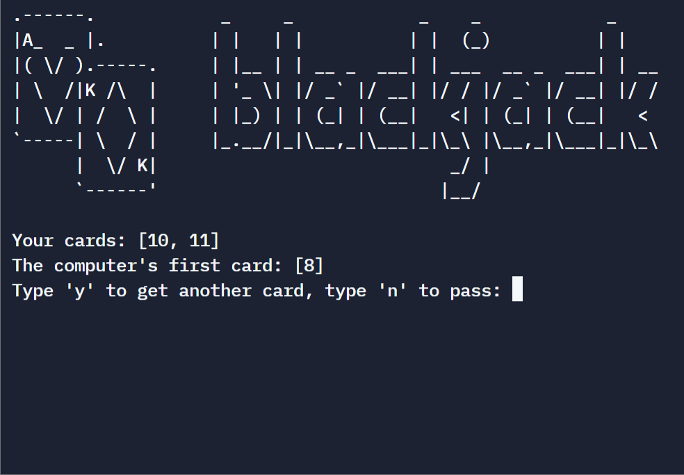

# Blackjack Game

A simple command-line Blackjack game built with Python. The player draws cards against the computer and tries to score closer to 21 without going over.

## Features

- Random card dealing
- Automatic Ace scoring
- Player hit/pass actions
- Computer opponent
- Win, loss, and draw results

## Run

Open `main.ipynb` in Jupyter Notebook and run all cells. The `art.ipynb` notebook provides the game logo.
